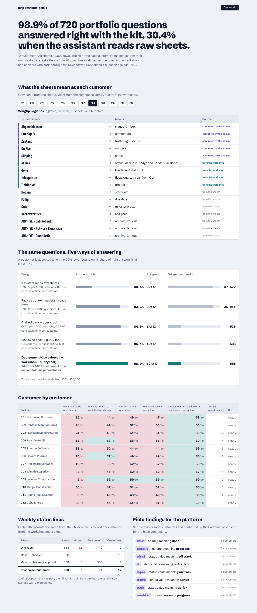

# mcp-resource-packs

Smartsheet's MCP server lets Claude, Copilot, ChatGPT and Gemini read a customer's live sheets. What no connector can
read is what those sheets **mean at this customer**: that "Zustand" is the traffic light and "Slipping" is amber, that
progress is typed as 45 and not 0.45, that tasks hang under phase rows, that "zz_Fleet Refit (old)" is an archive and
the RAID log is not a plan, that a task here is at risk when it is due within 7 days and under 80% complete, that the
financial year starts in October, and that "gate" means milestone.

This repository is the forward deployed engineer's kit for that gap. It drafts a **resource pack** for each customer
from their own workspace, asks their admin only about what it could not be sure of, records the rules from a
one-hour workshop, serves the pack through a **TypeScript MCP server** with a `portfolio_query` tool that answers
with code, picks the **multi-agent pattern** that writes their weekly status lines, and hands it all over as a
**Deployment Kit** a solutions consultant with no engineering background can follow, with a lint that says when a kit
is not done.

On 12 simulated customers (211 sheets, 12,879 rows, 6 with an older template still in use) and their
720 questions:

- **98.9% answered right with the kit against 30.4% for an assistant reading raw sheets**, and
  12 of 12 customers past the acceptance bar against 0.
- **558 tokens per question against 37,572**: €4.08 per 1,000 questions
  against €107.72. The pack alone, given as context while the assistant still reads rows, gets
  83.6%: the meanings fix the semantics, the query tool fixes the arithmetic.
- **1.6 consultant hours per customer**, most of it the workshop. Inference made
  28 decisions it was unsure of across all customers; every decision it was sure of was right.
- **0 wrong status lines** from the patterns chosen per customer, against 18 of 338 for one agent alone;
  regulated customers get a person approving every line (50 person minutes in all).
- **12 of 12 Deployment Kits pass the lint.**



## How a customer goes live

| Step | Who | Module | What happens |
|---|---|---|---|
| Draft | code | `infer.py` | Sheets grouped by template; each column gets a role from its title (base lexicon) and its values (types, ranges, which date is always later, what a ticked box coincides with); status values mapped by the lexicon, then by picklist order; archives and non-plan sheets recognised. Every decision carries a confidence and its evidence. |
| Confirm | customer's admin | `review.py`, `kits.py` | Decisions under 80% confidence become plain questions ("When a row's status says \"Slipping\", does that mean at risk?"). |
| Workshop | customer's project leads | `review.py` | The rules no sheet shows: when a task and a project are at risk, when the financial year starts, what "done" means, how milestones are marked, regulated or not, the customer's own words. |
| Serve | MCP server | `server/` | `pack://rules`, `pack://glossary`, `pack://semantics` as resources; `portfolio_query` (read-only) computes counts, lists, averages and the busiest assignee with the customer's meanings; a `weekly_portfolio_review` prompt. Reads a snapshot or the Smartsheet REST API with the customer's own token. |
| Write | agents | `patterns.py` | Weekly status line per project: one agent, maker + checker (the checker recomputes every number with the engine), or maker + checker + a person approving each line, chosen from the workshop answers and a pilot. |
| Hand over | consultant | `kits.py` | RUNBOOK, WORKSHOP, ACCEPTANCE and pack.json per customer; the lint blocks jargon, steps with no finish line, unconfirmed decisions, unsettled rules and acceptance under target. Example: [kits/C08](kits/C08/RUNBOOK.md). |
| Learn | FDE team | `evaluate.py` | Titles and values that went to review at several customers become proposals for the base vocabulary. |

## Results on the dev world

Same customers, same questions, same luck for every design. Acceptance is the Wilson 95% lower bound on the share of
a customer's 60 questions answered right, at least 85%.

| Design | Questions answered right | Customers accepted | Tokens per question | Cost per 1,000 questions | Consultant time per customer |
|---|--:|--:|--:|--:|--:|
| Assistant reads raw sheets | 30.4% (219/720) | 0 of 12 | 37,572 | €107.72 | 0.0 h |
| Pack as context, assistant reads rows | 83.6% (602/720) | 3 of 12 | 36,911 | €105.87 | 1.1 h |
| Drafted pack + query tool | 84.9% (611/720) | 1 of 12 | 536 | €4.02 | 0.0 h |
| Reviewed pack + query tool | 85.1% (613/720) | 1 of 12 | 536 | €4.02 | 0.1 h |
| **Deployment Kit** (reviewed + workshop + query tool) | 98.9% (712/720) | 12 of 12 | 558 | €4.08 | 1.6 h |

Why answers went wrong:

| Design | Customer's own word | Question misread | Row miscounted while reading | Wrong semantics |
|---|--:|--:|--:|--:|
| Assistant reads raw sheets | 27 | 8 | 173 | 293 |
| Pack as context, assistant reads rows | 0 | 8 | 110 | 0 |
| Drafted pack + query tool | 27 | 8 | 0 | 74 |
| Reviewed pack + query tool | 27 | 8 | 0 | 72 |
| Deployment Kit (reviewed + workshop + query tool) | 0 | 8 | 0 | 0 |

- **Raw sheets** fail on meaning before arithmetic: an unfamiliar title or status word, archived projects counted as
  live, phase rows counted as tasks, the calendar quarter for the fiscal one, 100% taken as done where the customer
  signs off with a tick box.
- **The drafted pack** gets the columns right and the rules wrong: 9 of 12 customers define "at risk"
  beyond the status column, 4 have a financial year that does not start in January. The admin review fixes
  columns; only the workshop fixes rules, which is why the kit, not the draft, passes acceptance.
- **The kit's** remaining misses are questions the assistant turned into the wrong query.

## Weekly status lines: choosing the pattern

| Pattern | Status lines written | Wrong | LLM calls | Person minutes |
|---|--:|--:|--:|--:|
| One agent | 338 | 18 | 338 | 0 |
| Maker + checker | 338 | 0 | 356 | 0 |
| Maker + checker + approval | 338 | 0 | 356 | 338 |
| **Chosen per customer** | 338 | 0 | 356 | 50 |

One agent alone writes wrong lines (a miscount, a wrong colour). A pilot of 2 weeks cannot show that rate is within
a customer's tolerance at 95% confidence, so no customer got the single agent: the checker costs
18 extra LLM calls in 338 lines and removes the wrong ones. Regulated customers
(2) get approval on every line for the audit trail, not for accuracy.

## Field findings for the platform

Titles and values inference was unsure of at two or more customers, with what the admins answered. These are the
proposed additions to the base vocabulary (`src/resourcepacks/lexicon.py`):

| Seen as | Kind | Admins said | Customers |
|---|--:|--:|--:|
| `closed` | column role | done | C04, C05, C11 |
| `erledigt %` | column role | progress | C03, C06, C08 |
| `critical` | status value | off track | C01, C02, C10 |
| `ok` | status value | on track | C01, C02, C10 |
| `on plan` | status value | on track | C04, C08, C10 |
| `slipping` | status value | at risk | C04, C08, C10 |
| `watch` | status value | at risk | C01, C02, C10 |
| `completion` | column role | progress | C01, C04 |

## Held-out world (run once)

Not run yet. `python scripts/evaluate.py --heldout` runs it once and writes `config/heldout.lock`.

## The MCP server

```bash
cd server && npm ci && npm run build
PACK=../data/example/pack.json SNAPSHOT=../data/example/workspace.json TODAY=2026-11-16 node dist/main.js   # demo
PACK=../kits/C08/pack.json SMARTSHEET_TOKEN=... node dist/main.js                                       # live workspace
```

In Claude Desktop (`claude_desktop_config.json`):

```json
{"mcpServers": {"resource-pack": {"command": "node", "args": ["/path/to/server/dist/main.js"],
  "env": {"PACK": "/path/to/kits/C08/pack.json", "SMARTSHEET_TOKEN": "..."}}}}
```

The TypeScript engine is a port of `src/resourcepacks/engine.py`; `server/test/conformance.test.ts` checks both give
the same answer on every query in `server/test/fixtures/conformance.json` (one workspace under seven rule variants).

## Run it

```bash
pip install -r requirements-lock.txt && pip install -e . --no-deps
python -m pytest -q                      # Python tests
python scripts/evaluate.py               # dev world -> reports/dev.json
python scripts/gate.py                   # quality gate (config/gate.toml)
python scripts/export.py                 # example workspace, conformance fixture, example kit
python scripts/readme.py                 # README.md and web/public/data/console.json
cd server && npm ci && npm test          # MCP server and conformance
cd web && npm ci && npm run build        # console
```

## Limits

- Customers, workspaces, the admin's answers and the assistant's mistakes are simulated, with their behaviour set in
  `config/world.toml`; the conventions are ones I wrote from how Smartsheet plans are commonly built. A real
  engagement starts by drafting the pack on the customer's own workspace and comparing it with their admin.
- `SmartsheetSource` follows the Smartsheet API 2.0 sheet shape and is tested against a fake; it has not run against a
  live account.
- The workshop is recorded as answers, not run with people; the consultant minutes are planning figures.
- Questions are the nine kinds in `world/sim.py`; free-form questions outside them are the assistant's job.

Repository: https://github.com/manojrevenkar12-web/mcp-resource-packs
